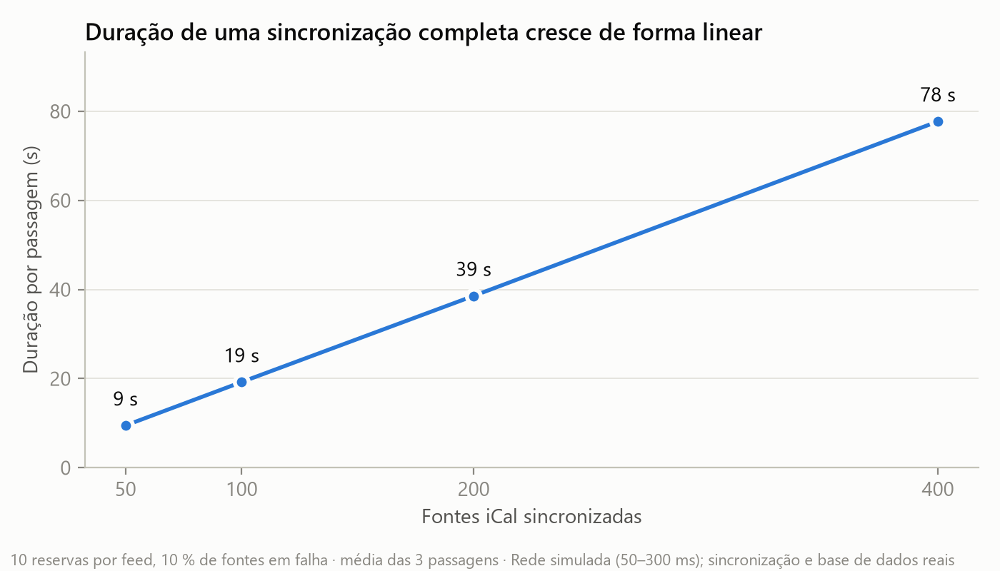
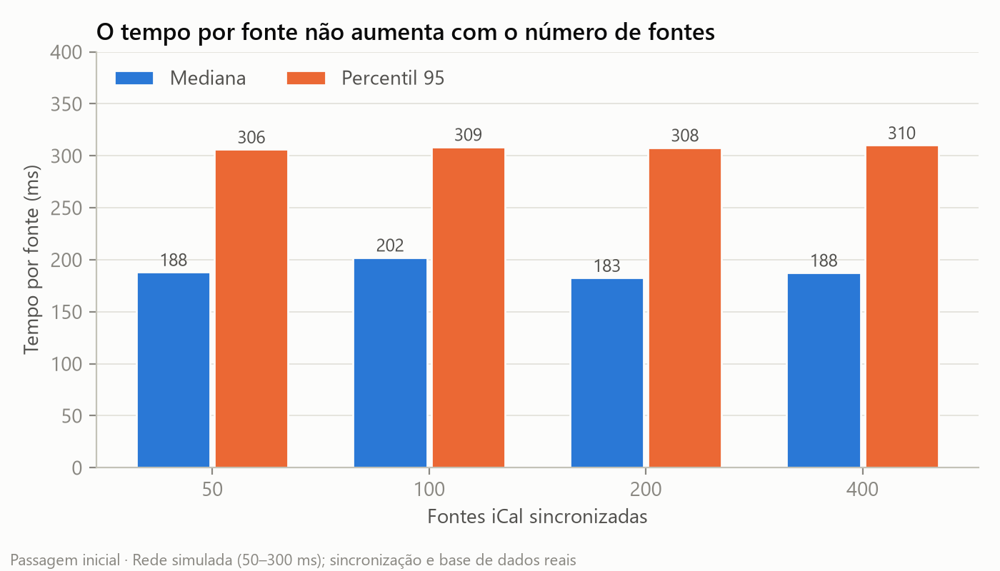
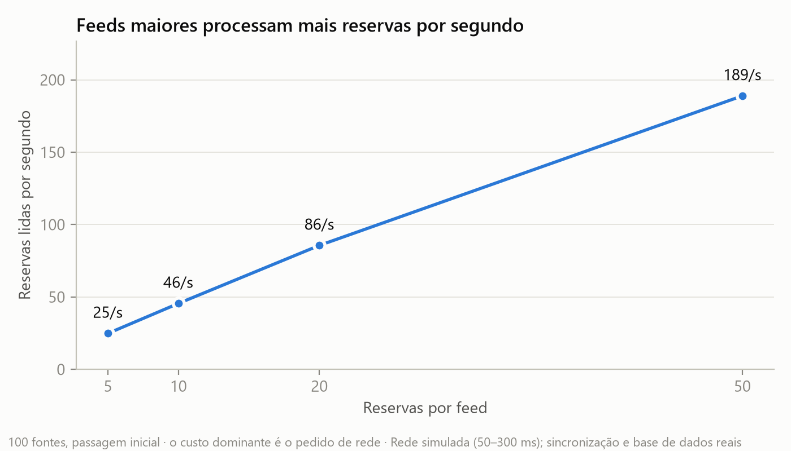
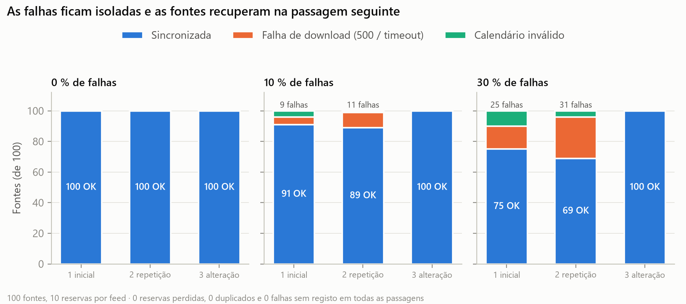
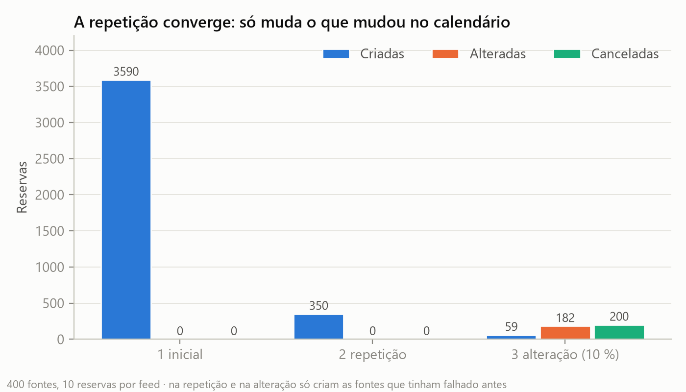

# Medições da sincronização iCal

Resultados do comando `reservations:benchmark` (issue #125), corrido a 27/11/2026 sobre o commit `fa47809`.

## Ambiente

| | |
|---|---|
| Máquina | Windows 10.0 (AMD64), portátil de desenvolvimento |
| PHP / Laravel | 8.4.26 / 13.33.0 |
| Base de dados | MariaDB 10.4.27 (XAMPP), base dedicada `cleancheck_bench` |
| Fila e cache | `database` |
| Execução | Sequencial, um processo, sem listeners (só a sincronização) |

## Método

- Cada execução cria N imóveis e fontes iCal fictícias (`https://ical-bench.test/...?s=fict`) com feeds ao estilo Airbnb (`VALUE=DATE`, `SUMMARY:Reserved`), gerados de forma determinística.
- **Só a rede é simulada** (`Http::fake`, latência aleatória de 50–300 ms por pedido). A leitura do calendário, a importação, os locks e a base de dados são os reais. Nenhum pedido sai para a internet (`preventStrayRequests`).
- Três passagens por execução:
  1. **inicial**: primeira leitura, com uma percentagem de fontes em falha (erro 500, timeout ou calendário inválido);
  2. **repetição**: os mesmos feeds, com outras fontes em falha;
  3. **alteração**: sem falhas, com 10 % das reservas removidas ou com o check-out adiado um dia.
- Depois de cada passagem, o comando confere a base de dados com o último feed lido com sucesso de cada fonte e conta: fontes divergentes, reservas duplicadas, sincronizações presas em "running" e falhas sem registo em `sync_runs`.

Para repetir (numa base com "bench" no nome):

```powershell
php artisan reservations:benchmark --fresh --sources=100 --events=10 --fail=10 --change=10 --latency=50-300
```

## Resultados

### Escala (10 reservas por feed, 10 % de falhas)

| Fontes | Duração por passagem | Mediana por fonte | p95 por fonte | Memória máx. |
|---:|---:|---:|---:|---:|
| 50 | 9,5 s | 188 ms | 306 ms | 44 MB |
| 100 | 19,2 s | 202 ms | 309 ms | 48 MB |
| 200 | 38,6 s | 183 ms | 308 ms | 52 MB |
| 400 | 77,7 s | 188 ms | 310 ms | 62 MB |




A duração cresce de forma linear (~190 ms por fonte) e o tempo por fonte não piora com o volume. Quase todo esse tempo é a latência simulada (média de 175 ms); a leitura, a importação e a base de dados ficam em ~15–25 ms por fonte.

### Volume do feed (100 fontes, passagem inicial)

| Reservas por feed | Reservas lidas/s | Mediana por fonte | Consultas SQL por fonte |
|---:|---:|---:|---:|
| 5 | 25 | 178 ms | 16 |
| 10 | 46 | 202 ms | 25 |
| 20 | 86 | 214 ms | 43 |
| 50 | 189 | 246 ms | 98 |



O custo dominante é o pedido de rede: um feed com 10× mais reservas demora só ~40 % mais. Cada reserva custa cerca de 2 consultas SQL (`firstOrCreate`).

### Falhas e recuperação (100 fontes)

| Falhas | Sincronizadas (1 / 2 / 3) | Criadas (1 / 2 / 3) |
|---:|---|---|
| 0 % | 100 / 100 / 100 | 1000 / 0 / 0 |
| 10 % | 91 / 89 / 100 | 910 / 90 / 0 |
| 30 % | 75 / 69 / 100 | 750 / 160 / 87 |



Uma fonte em falha não afeta as outras, mantém as reservas que já tinha e recupera na passagem seguinte em que o feed responde.

### Convergência (400 fontes)

| Passagem | Criadas | Alteradas | Canceladas |
|---|---:|---:|---:|
| 1 inicial | 3590 | 0 | 0 |
| 2 repetição | 350 | 0 | 0 |
| 3 alteração | 59 | 182 | 200 |



Na repetição só criam reservas as fontes que tinham falhado; na alteração só mudam as reservas alteradas ou removidas no feed.

### Verificações

Em todas as 27 passagens (9 execuções × 3): **0 fontes divergentes, 0 reservas duplicadas, 0 sincronizações presas e 0 falhas sem registo.**

## Leitura para a operação

- A sincronização agendada corre a cada 30 minutos. Com latências semelhantes às simuladas, 400 fontes demoram ~1,3 min num só worker, bem dentro dessa janela.
- Uma falha do Airbnb fica registada em `sync_runs` com o motivo e nunca apaga reservas: a fonte recupera na execução seguinte.

## Limitações

- A rede é simulada; os tempos reais dependem da resposta do Airbnb.
- Medido numa máquina de desenvolvimento, com um processo, sem workers em paralelo.
- Sem listeners: a criação de tarefas e avisos não entra nestes tempos (pode medir-se com `--with-listeners`).
